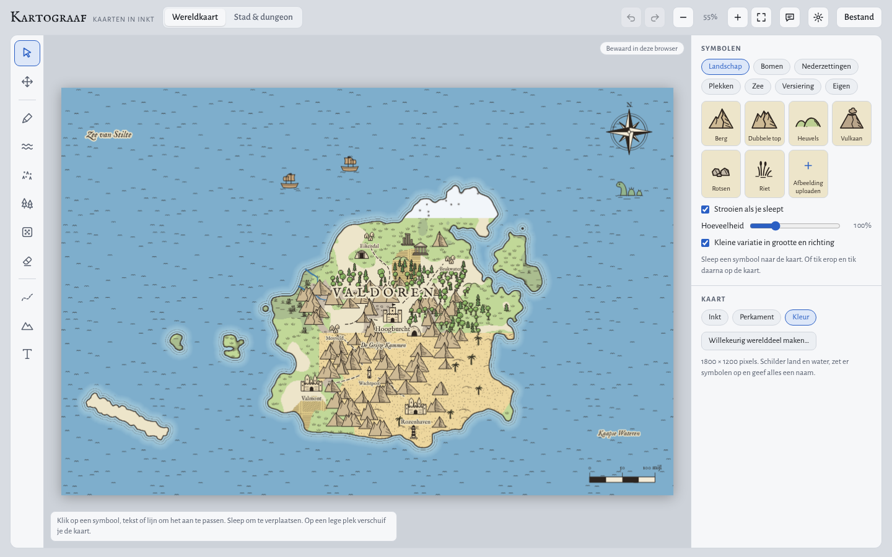
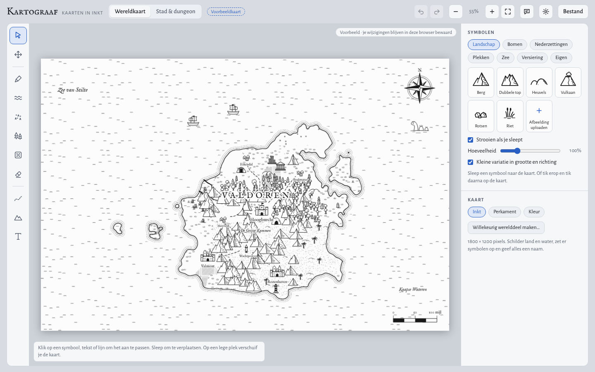

# Kartograaf

Teken je eigen fantasykaarten in de browser: wereldkaarten met kusten, bergketens en bossen, of plattegronden van steden en dungeons. In zwart-wit inkt, sepia perkament of in kleur.

**Openen:** https://robinbollens-commits.github.io/Kartograpper/

Gratis, zonder account. Je kaarten blijven op je eigen toestel.

## Downloaden

Op de pagina [Releases](https://github.com/robinbollens-commits/Kartograpper/releases/latest) staan de installers:

| Toestel | Bestand | Zo installeer je |
|---|---|---|
| Windows | `Kartograaf-Setup-….exe` | Dubbelklik. Waarschuwt Windows dat de uitgever onbekend is, klik dan *Meer informatie › Toch uitvoeren*. |
| Android | `Kartograaf-….apk` | Open het bestand op je telefoon en sta *Installeren uit onbekende bronnen* toe. |

Een nieuwe versie installeer je gewoon over de oude heen. Je kaarten blijven bewaard.

## Installeren vanuit de browser

Kartograaf is ook een website die je als app kunt installeren. Daarna start hij vanaf je bureaublad of beginscherm en werkt hij zonder internet.

| Toestel | Zo installeer je |
|---|---|
| Windows, Mac, Linux (Chrome of Edge) | Open de link en klik rechts in de adresbalk op het installeer-icoon, of kies in het menu *App installeren*. |
| Android (Chrome) | Open de link, tik op ⋮ en kies *App installeren* of *Toevoegen aan startscherm*. |
| iPhone en iPad (Safari) | Open de link, tik op Delen en kies *Zet op beginscherm*. |

**Zonder internet of eigen server:** kies op deze pagina *Code › Download ZIP*, pak het uit en open `index.html` in je browser. Lettertypen en zip-import hebben dan wel internet nodig de eerste keer.

## Wat kan het?

- **Wereldkaarten:** land en water schilderen met ruwe kusten, ondergronden (gras, woestijn, moeras, sneeuw, …), rivieren, wegen en grenzen.
- **Land genereren:** een volledig werelddeel, of een stuk land op je bestaande kaart, met bergen, bossen, plaatsen en namen.
- **Strooipenselen:** bergketens en bossen schilderen met tien vormen per soort. Stel zelf penselen samen.
- **Stad & dungeon:** kamers op een raster, gearceerde rotsmuren, deuren, meubels en meer.
- **Eigen materiaal:** teken je eigen vormen en ondergronden, of upload afbeeldingen en hele mappen of zips met assets, gesorteerd per type.
- **Stijlen:** inkt, perkament of kleur, per kaart te kiezen.
- **Exporteren:** als PNG, of als bewerkbaar bestand.

## Je gegevens

- Alles wordt in je eigen browser bewaard (IndexedDB). Er wordt niets naar een server gestuurd.
- **Updates wissen niets.** Vóór een nieuwe versie iets aanraakt, bewaart ze automatisch een herstelpunt. Je vindt het bij *Instellingen › Bibliotheek › Herstelpunten*.
- Kaarten en bibliotheek zitten vast aan de browser en het adres waar je ze maakte. Wil je ze op een ander toestel of in een andere browser, gebruik dan *Bestand › Opslaan als bestand* en *Bestand › Bibliotheek opslaan als bestand*, en open ze daar weer.
- Wis je je browsergegevens voor deze site, dan zijn je kaarten weg. Bewaar belangrijke kaarten dus ook als bestand.

## Google Drive

In de webversie (en de vanuit de browser geïnstalleerde app) kun je je kaarten en bibliotheek in je eigen Google Drive bewaren: *Instellingen › Google Drive*. Kartograaf maakt daar een map **Kartograaf** en ziet alleen de bestanden die hij zelf aanmaakt.

Dit werkt **niet** in de Windows-installer, de Android-APK of de versie op claude.ai. Google laat aanmelden daar niet toe. Gebruik op die toestellen de web-app, of de volledige back-up (*Bestand › Volledige back-up opslaan*).

### Eenmalig: een Google Client ID maken (gratis)

1. Ga naar [console.cloud.google.com](https://console.cloud.google.com/) en maak een nieuw project, bv. *Kartograaf*.
2. *APIs & Services › Library*: zoek **Google Drive API** en klik *Enable*.
3. *APIs & Services › OAuth consent screen*: kies *External*, vul een app-naam en je e-mailadres in. Voeg bij *Scopes* `.../auth/drive.file` toe. Zet de app op *In production* (zolang hij in *Testing* staat, kunnen alleen de testgebruikers die je toevoegt zich aanmelden).
4. *APIs & Services › Credentials › Create credentials › OAuth client ID*: kies *Web application*. Zet bij *Authorized JavaScript origins*: `https://robinbollens-commits.github.io`
5. Kopieer de **Client ID** (eindigt op `.apps.googleusercontent.com`) en zet hem in `src/kartograaf.html` bij `const GOOGLE_CLIENT_ID = '';`. Draai daarna `python3 tools/build.py`. Een Client ID is niet geheim; die mag in de code staan.

Tot dat gebeurd is, kun je de Client ID ook plakken in *Instellingen › Google Drive*. Hij wordt dan alleen in die browser onthouden.

## Back-up

- *Bestand › Volledige back-up opslaan* bewaart al je kaarten én je bibliotheek in één bestand. Terugzetten gaat via *Bestand › Kaart of bibliotheek openen*.
- Vóór elk terugzetten, ophalen uit Drive of updaten maakt Kartograaf een herstelpunt (*Instellingen › Bibliotheek en back-up*).

## Feedback

Iets werkt niet, of heb je een idee? Klik in de app op het tekstballon-icoon rechtsboven, of [maak hier een melding](https://github.com/robinbollens-commits/Kartograpper/issues/new/choose).

## Voor ontwikkelaars

- De app is één HTML-bestand zonder buildstap. De bron staat in `src/kartograaf.html`.
- `python3 tools/build.py` maakt daar `index.html` van, met de app-onderdelen (manifest, service worker) erbij.
- Elke push naar `main` wordt automatisch gepubliceerd op GitHub Pages.
- Verhoog `APP_VERSION` in `src/kartograaf.html` bij elke release. Dat triggert het automatische herstelpunt bij gebruikers.

### Installers bouwen

- `desktop/` is de Windows-app (Electron) en `mobile/` de Android-app (Capacitor). Beide gebruiken dezelfde `index.html`.
- De workflow *Installers bouwen* maakt bij elke push de `.exe` en `.apk`. Staat er in `src/kartograaf.html` een `APP_VERSION` waarvoor nog geen release bestaat, dan maakt hij er automatisch een release van.

### Android-sleutel

Android installeert een update alleen als hij met dezelfde sleutel ondertekend is. Zet daarom eenmalig deze geheimen bij *Settings › Secrets and variables › Actions*:
`ANDROID_KEYSTORE_BASE64`, `ANDROID_KEYSTORE_PASSWORD`, `ANDROID_KEY_ALIAS`, `ANDROID_KEY_PASSWORD`.
Zonder die geheimen maakt de workflow alleen een test-APK, en die wordt nooit in een release gezet. Bewaar de sleutel goed: zonder kan de Android-app niet meer bijgewerkt worden.

## Licentie

[MIT](LICENSE). Lettertypen: IM Fell English en Alegreya Sans (SIL Open Font License, via Google Fonts). Zip-import: JSZip (MIT).

Gemaakt met hulp van Claude.
